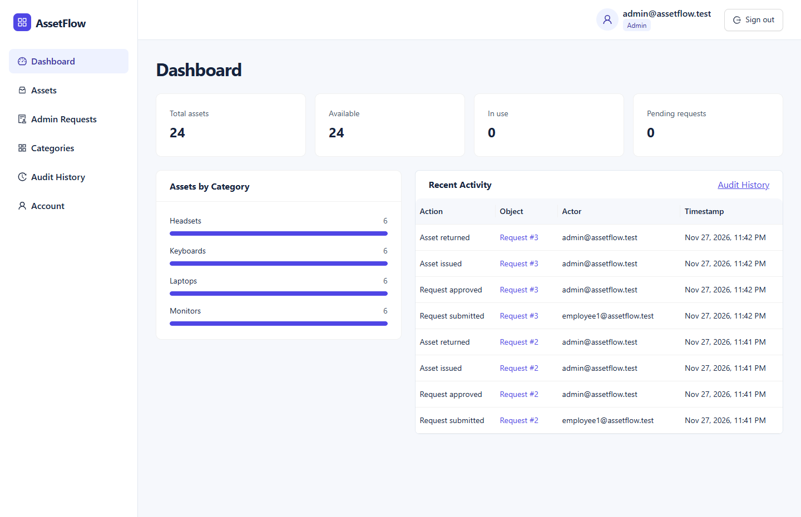
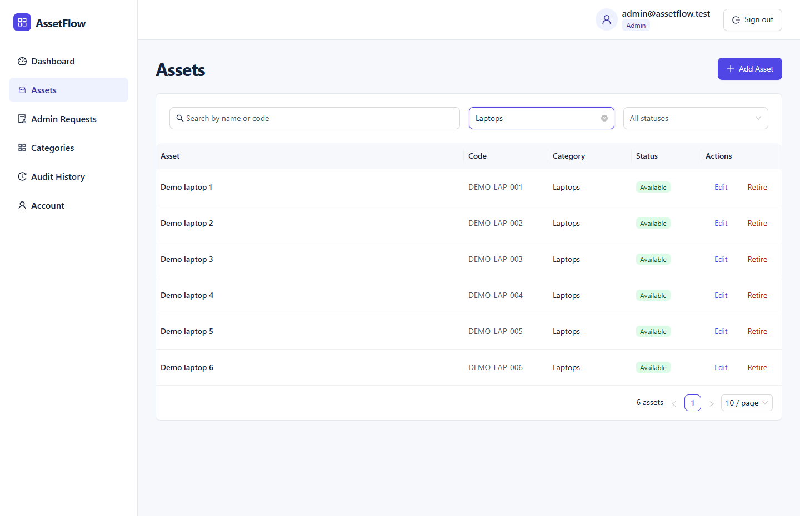
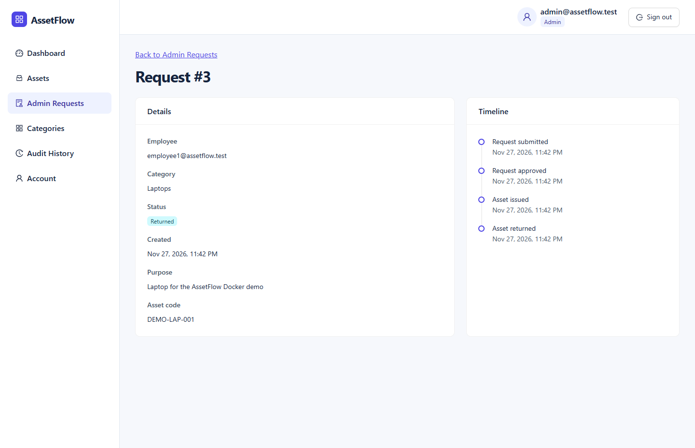

# AssetFlow

AssetFlow is an internal IT equipment management app. Employees browse equipment, request an asset by category, track their requests, and see their assigned devices. Admins manage inventory, approve or reject requests, issue devices, receive returns, and review the audit history.

## Screenshots

**Admin dashboard** with inventory counts and recent activity.



**Assets** filtered to laptops, with stock status and inventory actions.



**Request detail** showing a returned laptop and the full request timeline.



## Stack

- ASP.NET Core and .NET 10, Identity, JWT bearer authentication, EF Core, and Npgsql
- React, TypeScript, Vite, Ant Design, React Router, and TanStack Query
- PostgreSQL 17, Docker Compose, Nginx, and GitHub Actions

## Run the Docker demo

Install Docker Desktop with Compose, Git, and Node.js 22.14 or later. Open Git Bash and run:

```bash
git clone https://github.com/demian0711/assetflow.git
cd assetflow
node scripts/setup-env.mjs --add-jwt-key
```

In VS Code, open the generated `.env` and set `DemoSeed__Enabled=true`. From the repository root, run:

```bash
docker compose --profile full up -d --build
docker compose --profile full ps
curl -fsS http://localhost:8080/health/ready
```

Open [AssetFlow](http://localhost:8080). PostgreSQL starts first, the API applies migrations and seeds demo data, and Nginx serves the React app and proxies `/api` and `/health`. Compose keeps PostgreSQL data in a named volume. Reuse the same generated database credentials with that volume. Git ignores `.env`, and Compose supplies its secrets at runtime.

| Role | Email |
| --- | --- |
| Admin | `admin@assetflow.test` |
| Employee | `employee1@assetflow.test` |
| Employee | `employee2@assetflow.test` |

Open `.env` locally and copy the value after `DemoSeed__Password=` into the password field. The seed uses that value when it first creates the demo accounts. It adds four categories and 24 devices and can run again without duplicating them.

To demo the lifecycle, submit a request as an Employee, then sign in as Admin to approve and issue a device from the selected category. Check **Assigned Assets** as the Employee. Sign in as Admin to receive the return and view the result in **Dashboard** and **Audit History**. Reloading a page clears the in-memory session. After sign-in, the app reopens that page.

To stop the demo and keep its data, run `docker compose --profile full stop`.

## Run in development

Install the .NET 10 SDK as well. Use Git Bash from the repository root after generating `.env` as shown above.

```bash
docker compose up -d --wait db
dotnet tool restore
bash scripts/db-update.sh
bash scripts/dev-api.sh
```

In a second Git Bash terminal at the repository root, run:

```bash
cd web
npm ci
npm run dev
```

Open [Vite](http://localhost:5173). Vite proxies API and health requests to `http://localhost:5080`. PostgreSQL listens on `127.0.0.1:5434`.

## Build and test

From the repository root, build the solution and create a dedicated database for integration tests. Run `createdb` once per test database. Use the local `POSTGRES_USER` and `POSTGRES_PASSWORD` from `.env` in the connection string.

```bash
dotnet build AssetFlow.slnx -c Release
docker compose exec -T db sh -c 'createdb -U "$POSTGRES_USER" assetflow_integration'
ASSETFLOW_TEST_DB='Host=127.0.0.1;Port=5434;Database=assetflow_integration;Username=<local-user>;Password=<local-password>' \
  dotnet test AssetFlow.slnx -c Release --no-build

cd web
npm ci
npm run lint
npm run typecheck
npm run build
```

GitHub Actions runs these backend and frontend checks on pushes and pull requests. The backend job starts its own PostgreSQL 17 service.
